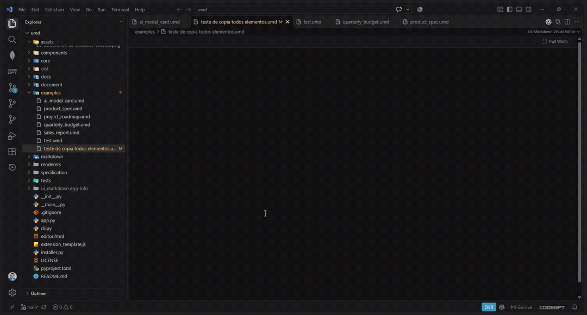
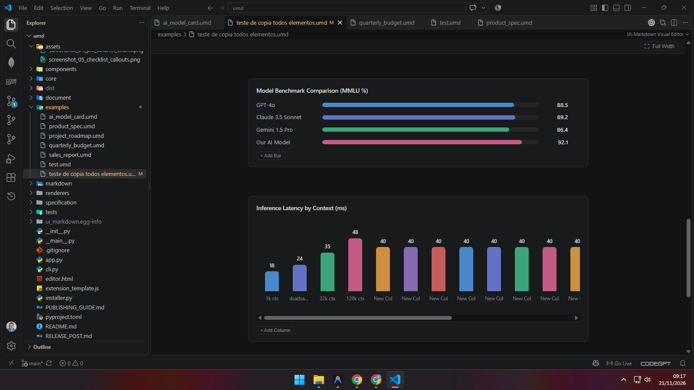
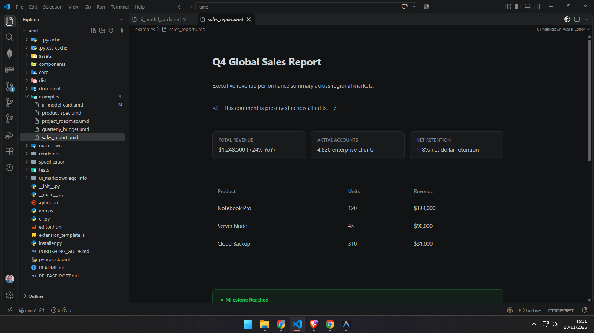

<div align="center">

# UI-Markdown (UMD)

**Interactive Visual Documents in Pure Plain Text**

[](https://www.python.org/)
[](LICENSE)
[]()
[](https://github.com/filipealvesr2019/umd/actions/workflows/ci.yml)
[](https://codecov.io/gh/filipealvesr2019/umd)
[]()
[](docs/TUTORIAL.md)

*Combine fluid Markdown writing with interactive UI blocks, live editable data charts, rich typography controls, and architecture pipelines — stored cleanly in a single `.umd` file with zero companion files.*

**Português (BR): [README.pt-BR.md](README.pt-BR.md)**

[Live Demo](#-live-demo) • [Overview](#-overview) • [Key Features](#-key-features) • **[📖 Editor Tutorials](#-visual-editor-tutorials-all-features)** • [Quick Start](#-quick-start) • [Syntax Reference](#-syntax--component-reference) • [Python API](#-python-api) • [License](#-license)

<br/>



<br/>

<a name="-live-demo"></a>
*🎬 Live demo of UI-Markdown (UMD) visual editor in action*

</div>

---

## 🌟 Overview

**UI-Markdown (`.umd`)** bridges the gap between readable plain-text Markdown and rich visual document editors.

Traditional documentation tools often force you to choose between:
1. **Plain Markdown**: Lightweight and Git-friendly, but visually plain with limited interactivity and no structured visual components.
2. **Proprietary Document Apps**: Visually rich, but locked inside proprietary databases or accompanied by messy multi-file bundles (`.html`, `.json`, companion asset folders).

**UMD solves this.** Every document is stored entirely in **pure human-readable text** under the `.umd` extension, with an AST-backed parser guaranteeing **100% lossless roundtrip preservation**.

> 📖 **New to UMD?** Read the complete step-by-step **[Editor User Guide & Tutorial](docs/TUTORIAL.md)** to master every tool, chart, and shortcut.

<div align="center">
  
</div>

---

## ✨ Key Features

- **📄 Zero Companion Files**: Everything — styled text, metrics, charts, pipelines, callouts, checklists, images, and tables — lives cleanly in one plain `.umd` text file.
- **🔁 Full `.md` Compatibility (`Open with UMD`)**: Open any standard `.md` or `.markdown` file directly in the UMD Visual Editor without changing your default Markdown text editor — just right-click any `.md` file in the Explorer, Editor, or Tab bar and click **Open with UMD** (or **Open With... → UMD Visual Editor**). Supports full Markdown syntax including ATX (`#`–`######`) & Setext (`===`/`---`) headings, inline & reference links/images, linked images, footnotes (`[^id]`), escaped punctuation (`\*`, `\|`), nested blockquotes, `+`/`*`/`-` & indented lists, task lists, multi-table documents, and inline `<dl>` blocks.
- **🎨 Interactive Visual Editor**: Seamless WYSIWYG editor built for **Antigravity IDE** and **VS Code**, featuring instant right-click component insertion, **`Ctrl+F` / `Cmd+F` live find & highlight**, full document **Undo/Redo** (`Ctrl+Z` / `Ctrl+Y` / `Ctrl+Shift+Z`), **hover-only scrollbars & action buttons** for a distraction-free canvas, and real-time live sync.
- **🌗 Automatic Dark & Light Themes**: Automatically adapts to VS Code / Antigravity `vscode-dark` and `vscode-light` themes (as well as OS `prefers-color-scheme`) with dedicated palettes for code syntax highlighting, charts, tables, floating toolbars, and menus.
- **🖼️ Native Image Blocks (`[IMAGE]` & ``)**: Open local images from anywhere on your PC (**Open Image**), embed direct image URLs, edit captions inline, and resize with hover presets (`S / M / L / Full`) — storing only clean plain-text paths in `.umd` (zero Base64 bloat).
- **📝 Smart Code & Auto-Wrapping Plain-Text Blocks**: Syntax-highlighted code blocks (`python`, `json`, `html`, `js`, `sql`, `bash`) plus automatic word-wrapping in `text` blocks so long transcripts and outputs never require horizontal scrolling.
- **🤖 Built for AI Agents & Automated Reports**:
  - **`umd spec` & `umd install-skill`**: One-command compact syntax reference and global `SKILL.md` installer for **Antigravity**, **Claude Code**, and **Cursor**.
  - **`umd check --json` & `umd outline --json`**: Machine-readable validation with fix hints and fast structural outlines for navigating large reports without blowing up context windows.
  - **Surgical CLI Edits**: Update tables (`umd add-row`), metrics/progress (`umd set-metric`), or charts (`umd append-chart`) in place without rewriting the whole file.
  - **Python `Report` Builder (`from umd.builder import Report`)**: Zero-dependency fluent Python API covering every editor element and inline text style for automated ML/benchmark experiment reports.
- **✍️ Universal Rich Typography Toolbar**: Select any text in any element (paragraphs, headings, tables, cards, callouts, or chart labels) to customize:
  - **Font Family** (`Sans`, `Serif`, `Mono`, `Casual`, `Display`)
  - **Font Size** (`11px` to `36px`)
  - **Letter Spacing** (`-1px` to `+5px`, or `Normal`)
  - **Text Color** (10 quick palette swatches + custom color picker)
  - **Inline Styles** (**Bold**, *Italic*, <u>Underline</u>, ~~Strikethrough~~, `Inline Code`, and quick Copy)
- **🔄 Lossless Bi-Directional Roundtrip**: Visual edits immediately sync back to clean `.umd` Markdown without reordering blocks, mangling comments, or breaking formatting.
- **📊 Interactive Data & AI Charts Built-In**:
  - **Comparison Column Charts (`comparison`)**: Grouped multi-series vertical bars with dynamic `+ Add Comparison Series` and `+ Add Group`, inline value editing, and legend customization.
  - **Curved Spline Line Charts (`curved`)**: Smooth cubic Bézier trajectories where you can click the canvas to add a new curve, click any curve to insert points, drag points vertically, or click points/X-axis labels to edit inline.
  - **Multi-Series Line Charts (`line`)**: Direct SVG plotting with interactive point popovers, drag-to-adjust values, and inline X-axis label editing.
  - **Vertical Column Charts (`column`)**: Uniform-width bars, values anchored directly above each bar, and truncated labels with full-text hover tooltips.
  - **Horizontal Bar Charts (`bar`)**: Benchmark comparisons with proportional bars.
  - **Pie / Donut Charts (`pie`)**: Dataset mixtures and distributions with interactive legends.
- **🧩 Structured Layout & Workflow Blocks**:
  - **AI Pipeline Architecture (`[PIPELINE]`)**: End-to-end step flows (`Input -> Process -> Output`).
  - **Stat Cards & Multi-Column Grids (`[COLUMNS]`, `[CARD]`)**: Responsive metric dashboards.
  - **Progress Bars (`[PROGRESS]`)**: Multi-stage training, project, or milestone tracking.
  - **Callouts (`[CALLOUT]`)**: Styled banners (`info`, `success`, `warning`, `danger`, `note`).
  - **Interactive Checklists & Tables**: Toggleable task lists and editable grids with dynamic row/column controls.
- **📋 Clean Clipboard Export**: Copy content directly into Google Docs, Word, or chat apps without carrying over editor buttons or UI overlays.
- **🛡️ Security-First Core**: Built-in XSS defense, attribute breakout protection, sanitized URLs (`javascript:`/`vbscript:` neutralization), and resilient fuzz handling.
- **⚡ Zero External Dependencies**: Core engine is 100% standard-library Python with lightning-fast execution (<1ms parse time).

---

## 📊 Rich AI & Data Visualizations

### 1. Benchmark Horizontal Bar Charts
Compare LLM benchmarks, evaluation scores, or accuracy metrics with auto-calculated visual bars:

<div align="center">
  
</div>

### 2. Vertical Column & Pie / Donut Charts
Visualize latency across context lengths with uniform-width columns, hover tooltips on long labels, and dataset token distributions:

<div align="center">
  
</div>

### 3. Reactive Progress, Callouts & Checklists
Track alignment stages with progress meters, status banners, and interactive task checkboxes:

<div align="center">
  
</div>

---

## 🚀 Quick Start

### 1. Installation

Install via pip:

```bash
pip install ui-markdown
```

### 2. Install the IDE Extension

Activate the visual editor in VS Code and Antigravity IDE with a single command:

```bash
umd install
```

> **Tip:** Reload your IDE (`Ctrl+Shift+P` → `Developer: Reload Window`). Click any `.umd` file to open it directly in the visual editor, or **right-click any `.md` file → `Open with UMD`** to view and edit standard Markdown files visually!

---

## 📖 Visual Editor Tutorials (All Features)

Everything in UI-Markdown can be created and edited visually right on the canvas. Explore the quick tutorials below or open the **[Complete Step-by-Step User Guide (`docs/TUTORIAL.md`)](docs/TUTORIAL.md)** for full details.

| Tutorial Topic | What You Will Learn | Direct Link |
| :--- | :--- | :--- |
| **1. Getting Started & Layout** | Installing the IDE extension, opening `.umd` files, and toggling **Full Width** mode | [Read Guide →](docs/TUTORIAL.md#1-getting-started) |
| **2. Typography & Text Styling** | Changing **Font Family**, **Font Size**, **Letter Spacing**, **Text Color** (palette + custom picker), **Bold / Italic / Underline / Strike / Code** on any element | [Read Guide →](docs/TUTORIAL.md#2-working-with-text--typography) |
| **3. Right-Click Component Menu** | Inserting headings (H1–H4), lists, toggles, tables, charts, pipelines, and deleting blocks | [Read Guide →](docs/TUTORIAL.md#3-inserting-components-context-menu) |
| **4. Interactive Data Charts** | Editing Comparison Columns, Curved Spline Lines, Multi-Series Lines, Vertical Columns, Horizontal Bars, and Pie/Donut charts directly on canvas | [Read Guide →](docs/TUTORIAL.md#4-interactive-data-charts) |
| **5. Cards, Pipelines & Callouts** | Building Metric Card grids, AI architecture pipelines, progress meters, and styled callouts | [Read Guide →](docs/TUTORIAL.md#5-layout-cards-pipelines--callouts) |
| **6. Tables, Checklists & Toggles** | Dynamic table rows/columns, interactive to-do checkboxes, collapsible toggle lists, quotes, code blocks, and dividers | [Read Guide →](docs/TUTORIAL.md#6-tables-checklists-toggles--code-blocks) |
| **7. Clean Clipboard Export** | Copying tables, charts, and styled text cleanly into Google Docs, Word, Sheets, or chat apps | [Read Guide →](docs/TUTORIAL.md#7-clipboard--clean-export) |
| **8. Keyboard Shortcuts** | Essential shortcuts for fast visual editing | [Read Guide →](docs/TUTORIAL.md#8-keyboard-shortcuts) |

### Quick How-To Highlights

- **Format Any Text Anywhere:** Select any text (in paragraphs, headings, tables, cards, callouts, or chart labels) to open the floating toolbar. Combine **Font**, **Size**, **Spacing** (`letter-spacing`), **Color** (10 swatches + custom color picker), and **B / I / U / S / `<>`** — the toolbar stays open while you apply multiple styles.
- **Insert Any Block:** **Right-click** anywhere on the canvas to insert headings, lists, checklists, toggle lists, tables, callouts, metric cards, pipelines, progress bars, or any of the 6 interactive chart types.
- **Edit Curved & Line Charts Visually:** Click empty canvas space to add a new curve/line, click directly on any curve to insert a point, click any point to edit/delete its value, drag points vertically, or click X-axis labels to rename them inline.
- **Edit Comparison & Column Charts:** Click **`+ Add Comparison Series`** or **`+ Add Group`** / **`+ Add Column`**, click numbers above bars to edit values in real time, and hover over truncated long labels to view the full name.
- **Copy Cleanly:** Press `Ctrl + C` (or right-click → **Copy**) to copy clean HTML + plain text without editor buttons or UI chrome.

---

## 💻 CLI Commands & AI-Agent Toolkit

The `umd` CLI provides fast validation, inspection, and surgical editing designed for both humans and AI agents:

```bash
# Install or update the VS Code / Antigravity visual editor extension
umd install

# Install the global AI-agent Skill (Antigravity, Claude Code, Cursor)
umd install-skill

# Print the compact UMD syntax reference for AI agents
umd spec

# Validate syntax, structure, and chart data (human or JSON with fix hints)
umd check document.umd
umd check document.umd --json

# Inspect headings, tables, charts, cards, and line numbers without reading the full file
umd outline document.umd --json

# Surgical in-place edits (dry-run by default; pass --write to save)
umd add-row report.umd --table 1 --values "Seed 133|HELD|88.0%" --write
umd set-metric report.umd --label "HELD" --value "7/8" --subtitle "87.5%" --write
umd append-chart report.umd --chart 1 --values "Exp 133|91.5" --write

# Render a .umd document to standalone HTML
umd render document.umd -o document.html
```

---

## 🧩 Syntax & Component Reference

UMD supports all standard CommonMark syntax along with interactive block components and inline typography styles. For a full interactive walkthrough, see **[docs/TUTORIAL.md](docs/TUTORIAL.md)**.

### 1. Comparison Column Chart (Multi-Series Grouped Bars)
```markdown
[CHART title="Population of Selected Countries (Millions)" type="comparison" series="2013, 2021"]
Germany | 80.6 | 83.2
Spain | 46.6 | 47.4
France | 65.8 | 67.7
Italy | 60.2 | 59.1
[/CHART]
```

### 2. Curved Spline Line Chart & Standard Line Chart
```markdown
[CHART title="Metric Trajectory Trends" type="curved" series="Series A, Series B, Series C"]
Jan | 75 | 50 | 48
Mar | 66 | -10 | 22
May | 70 | -18 | 14
Jul | 60 | 2 | 15
Sep | 62 | -12 | 8
[/CHART]

[CHART title="Training vs Validation Loss" type="line" series="Train Loss, Val Loss"]
Epoch 1 | 0.85 | 0.92
Epoch 2 | 0.62 | 0.71
Epoch 3 | 0.45 | 0.58
Epoch 4 | 0.34 | 0.49
[/CHART]
```

### 3. Bar, Column & Pie Charts
```markdown
[CHART title="Zero-Shot Reasoning Benchmark Scores (%)" type="bar"]
GPT-4o | 88.5
Claude 3.5 Sonnet | 89.2
DeepSeek-V3 | 88.8
DeepReason-70B (Ours) | 92.4
[/CHART]

[CHART title="Inference Latency by Context Length (ms)" type="column"]
2k Tokens | 14.2
8k Tokens | 22.8
32k Tokens | 41.5
128k Tokens | 104.3
[/CHART]

[CHART title="Pretraining Dataset Mixture (%)" type="pie"]
Code & Repositories | 35
Scientific Papers | 25
Web Curated Text | 20
Mathematical Proofs | 12
Conversational Dialog | 8
[/CHART]
```

### 4. Architecture Pipelines
```markdown
[PIPELINE title="End-to-End Inference Pipeline"]
User Query -> Semantic Tokenizer -> Mixture of Attention Layers -> Tool Calling Router -> Verifier Agent -> Streaming Output
[/PIPELINE]
```

### 5. Stat Cards & Multi-Column Grids
```markdown
[COLUMNS gap="20"]

[CARD title="PARAMETERS"]
70.6 Billion (Dense Decoder-Only)
[/CARD]

[CARD title="CONTEXT WINDOW"]
128,000 tokens
[/CARD]

[CARD title="TARGET MODALITY"]
Code, Math & Multi-Step Reasoning
[/CARD]

[/COLUMNS]
```

### 6. Reactive Progress, Callouts, Images & Inline Styling
```markdown
[PROGRESS label="Stage 2 Reinforcement Learning (RLVR)" value="94" max="100" /]

[CALLOUT tone="success" title="Verification Passed"]
All unit benchmarks, safety filters, and latency boundaries passed.
[/CALLOUT]

[IMAGE src="./plots/attention_heatmap.png" alt="Attention Heatmap" caption="Layer 4 Attention Map" width="640" /]

Highlighted text with <span style="color: #ef4444; font-size: 22px; letter-spacing: 2px;">custom typography</span> persists losslessly.
```

---

## 🐍 Python API & Report Builder

Generate complete `.umd` reports directly from your Python / ML experiment scripts with zero syntax errors using `umd.builder.Report`, or parse/render documents programmatically:

```python
from umd import Report, styled, inline_code, parse, render_document, Document

# 1. Build a complete visual report programmatically (all editor blocks & text styles)
report = (
    Report("Experiment 132 — Evaluation", "Automated benchmark summary")
    .p(f"Status: {styled('PASS', color='#10b981', bold=True)} on {inline_code('HELD01')}")
    .cards([
        ("TRAIN Exact", "18/20", "90.0%"),
        ("HELD Exact", "6/8", "75.0%"),
    ])
    .comparison_chart(
        "Accuracy by Regime (%)",
        [("TRAIN", [82.0, 90.0]), ("HELD", [62.5, 75.0])],
        series=["Exp 131", "Exp 132"],
    )
    .table(["Seed", "Regime", "Score"], [["130", "HELD01", "84.6%"]])
    .image("./plots/confusion_matrix.png", caption="Confusion Matrix", width=640)
    .callout("Zero syntax errors guaranteed.", tone="success", title="Verified")
)
report.save("report_132.umd")

# 2. Parse, validate & render to standalone HTML
doc = Document(report.render())
assert doc.valid
html_output = render_document(doc)
```

---

## 🧪 Testing & Verification

UMD includes a comprehensive test suite covering parser grammar, AST validation, AI-agent CLI & builder tools, roundtrip persistence, security escaping, Playwright visual editor interactions (undo/redo, text wrapping, image blocks, dark/light themes, interactive charts), and rendering:

```bash
pytest tests/
```

**Status:** 102 tests passing (unit, full `.md` compatibility, roundtrip, security, editing, charts, CLI, Playwright end-to-end, Hypothesis fuzzing and performance guards). Coverage: 76% (branch). See [docs/TEST_STRATEGY.md](docs/TEST_STRATEGY.md).

---

## 📄 License

Distributed under the **MIT License**. See [LICENSE](LICENSE) for full details.
