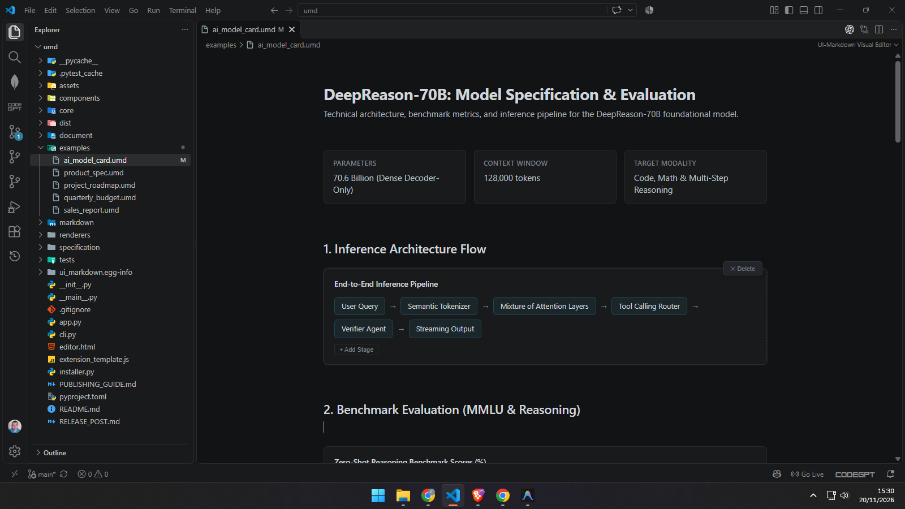
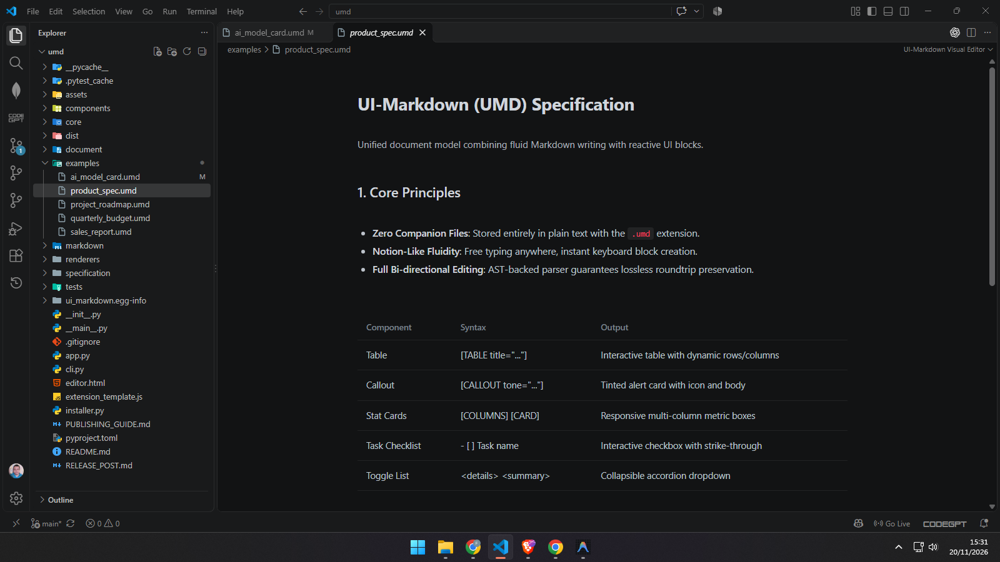
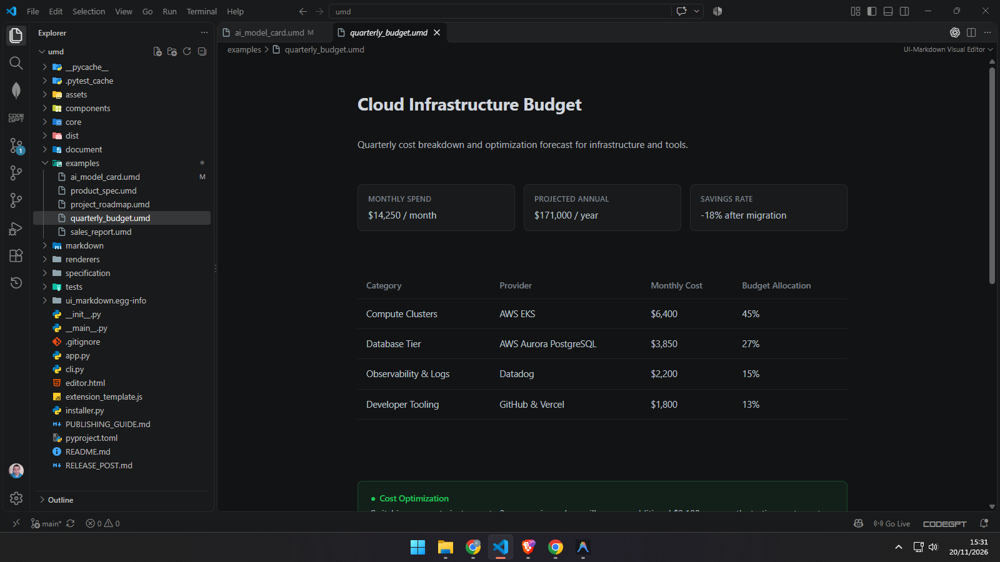

<div align="center">

# UI-Markdown (UMD)

**Interactive Notion-Style Visual Documents in Pure Plain Text**

[](https://www.python.org/)
[](https://opensource.org/licenses/MIT)
[]()
[]()

*Combine fluid Markdown writing with reactive UI blocks, data charts, and pipeline architectures — stored cleanly in a single `.umd` file with zero companion files.*

<br/>



</div>

---

## 🌟 Overview

**UI-Markdown (`.umd`)** bridges the gap between readable plain-text Markdown and rich visual workspace editors like Notion.

Traditional documentation tools often force you to choose between:
1. **Plain Markdown**: Lightweight and Git-friendly, but visually plain with limited interactivity and no structured visual components.
2. **Proprietary Workspace Apps**: Visually rich, but stored in proprietary databases or accompanied by messy multi-file bundles (`.html`, `.json`, folder companions).

**UMD solves this.** Every document is stored entirely in **pure human-readable text** under the `.umd` extension, with an AST-backed parser guaranteeing **100% lossless roundtrip preservation**.

<div align="center">
  
</div>

---

## ✨ Key Features

- **📄 Zero Companion Files**: Everything — text, metrics, bar charts, pie charts, pipelines, callouts, and tables — lives inside one plain `.umd` text file.
- **🎨 Interactive Visual Editor**: Seamless WYSIWYG editor built for **Antigravity IDE** and **VS Code**, featuring full keyboard navigation, right-click component menus, and real-time live preview.
- **🔄 Lossless Bi-Directional Roundtrip**: Visual changes immediately sync back to clean Markdown without reordering, mangling comments, or breaking formatting.
- **📊 AI & Data Graphics Built-In**:
  - **Horizontal Bar Charts**: Benchmark comparisons with proportional bars.
  - **Vertical Column Charts**: Latency, batch sizes, and context profiles.
  - **Pie / Donut Charts**: Dataset mixture and token distributions.
  - **AI Pipeline Architecture**: End-to-end model workflows (`Prompt -> Tokenizer -> Transformer -> Output`).
  - **Progress Cards**: Multi-stage fine-tuning and alignment tracking.
- **🛡️ Security-First Core**: Built-in XSS defense, attribute breakout protection, sanitized URLs (`javascript:`/`vbscript:` neutralization), and resilient fuzz handling.
- **⚡ Zero External Dependencies**: Core engine is 100% standard-library Python with lightning-fast execution (<1ms parse time).

---

## 📊 Rich AI & Data Visualizations

### 1. Benchmark Horizontal Bar Charts
Compare LLM benchmarks, evaluation scores, or accuracy metrics with auto-calculated visual bars:

<div align="center">
  
</div>

### 2. Vertical Column & Pie / Donut Charts
Visualize latency curves across context lengths and dataset token distributions with interactive legends:

<div align="center">
  
</div>

### 3. Reactive Progress, Callouts & Checklists
Track alignment stages with progress meters, status banners, and interactive task checkboxes:

<div align="center">
  
</div>

---

## 🚀 Quick Start

### 1. Installation

Install via pip:

```bash
pip install ui-markdown
```

### 2. Install the IDE Extension

Activate the visual editor in VS Code and Antigravity IDE with a single command:

```bash
umd install
```

> **Tip:** Reload your IDE (`Ctrl+Shift+P > Developer: Reload Window`). Click any `.umd` file to open it directly in the Notion-like visual editor!

---

## 💻 CLI Commands

The `umd` CLI provides high-performance document tools:

```bash
# Render a .umd document to standalone HTML
umd render document.umd -o document.html

# Validate syntax and check for structural errors
umd check document.umd

# Open the visual editor server
umd edit document.umd

# Re-install or update the IDE extension
umd install
```

---

## 🧩 Syntax & Component Reference

UMD supports all standard CommonMark syntax along with reactive block components:

### 1. AI & Data Charts
```markdown
[CHART title="Zero-Shot Reasoning Benchmark Scores (%)" type="bar"]
GPT-4o | 88.5
Claude 3.5 Sonnet | 89.2
DeepSeek-V3 | 88.8
DeepReason-70B (Ours) | 92.4
[/CHART]

[CHART title="Inference Latency by Context Length (ms)" type="column"]
2k Tokens | 14.2
8k Tokens | 22.8
32k Tokens | 41.5
128k Tokens | 104.3
[/CHART]

[CHART title="Pretraining Dataset Mixture (%)" type="pie"]
Code & Repositories | 35
Scientific Papers | 25
Web Curated Text | 20
Mathematical Proofs | 12
Conversational Dialog | 8
[/CHART]
```

### 2. Architecture Pipelines
```markdown
[PIPELINE title="End-to-End Inference Pipeline"]
User Query -> Semantic Tokenizer -> Mixture of Attention Layers -> Tool Calling Router -> Verifier Agent -> Streaming Output
[/PIPELINE]
```

### 3. Stat Cards & Columns
```markdown
[COLUMNS gap="20"]

[CARD title="PARAMETERS"]
70.6 Billion (Dense Decoder-Only)
[/CARD]

[CARD title="CONTEXT WINDOW"]
128,000 tokens
[/CARD]

[CARD title="TARGET MODALITY"]
Code, Math & Multi-Step Reasoning
[/CARD]

[/COLUMNS]
```

### 4. Reactive Callouts & Progress
```markdown
[PROGRESS label="Stage 2 Reinforcement Learning (RLVR)" value="94" max="100" /]

[CALLOUT tone="success" title="Verification Passed"]
All unit benchmarks, safety filters, and latency boundaries passed.
[/CALLOUT]
```

---

## 🐍 Python API

Integrate UMD programmatically into your scripts, CI/CD pipelines, or agent workflows:

```python
from umd import parse, render_document, Document

# 1. Parse UMD text into an AST
doc_text = """
# Model Evaluation
[PROGRESS label="Fine-Tuning" value=95 max=100 /]
"""
result = parse(doc_text)
print(f"Parsed {len(result.root.children)} root nodes.")

# 2. Render to self-contained HTML
html_output = render_document(doc_text, standalone=True)
with open("evaluation.html", "w", encoding="utf-8") as f:
    f.write(html_output)

# 3. Document Object Model editing
doc = Document.from_text(doc_text)
doc.append_paragraph("Evaluation completed successfully.")
print(doc.to_text())
```

---

## 🧪 Testing & Verification

UMD includes a comprehensive test suite covering parser grammar, AST validation, roundtrip persistence, security escaping, and visual rendering:

```bash
pytest tests/
```

**Status:** 68 passed (100% coverage across editing, parsing, rendering, roundtrip, and security modules).

---

## 📄 License

MIT License. Free and open-source for personal, academic, and enterprise software.
