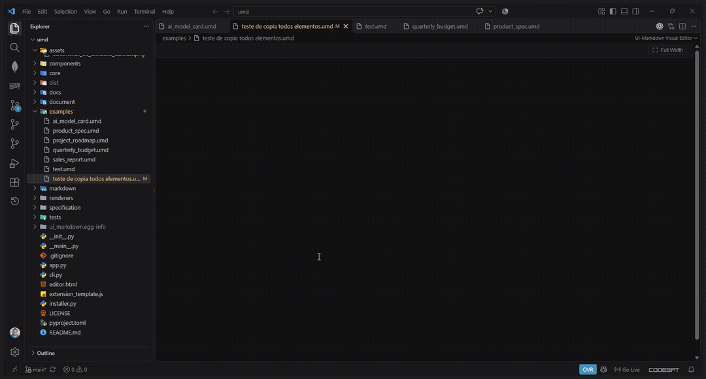

# UI-Markdown (UMD) Visual Editor

**Interactive Visual Documents in Pure Plain Text — for `.umd` and `.md` files.**

Combine fluid Markdown writing with live editable data charts, metric stat cards, architecture pipelines, progress bars, callouts, checklists, images, and rich typography — stored cleanly in a single plain-text file with zero companion files.

---

## Features

- **Zero Companion Files**: Every visual component, chart, table, and style persists cleanly inside a single plain-text `.umd` file.
- **Open Any `.md` File with UMD**: Right-click any `.md` or `.markdown` file in the Explorer, Editor, or Tab bar and click **Open with UMD** (or **Open With... → UMD Visual Editor**). Regular `.md` editing stays untouched by default.
- **6 Interactive Data Charts**: Horizontal Bar (`bar`), Vertical Column (`column`), Comparison Multi-Series (`comparison`), Pie / Donut (`pie`), Line (`line`), and Curved Spline (`curved`) — all editable directly on the canvas.
- **Rich Typography Floating Toolbar**: Select any text to change Font Family, Font Size, Letter Spacing, Color (palette + custom picker), Bold, Italic, Underline, Strikethrough, and Inline Code.
- **Native Image Blocks (`[IMAGE]` & ``)**: Open local images from your PC (**Open Image**), embed direct URLs, resize with hover presets (`S / M / L / Full`), and edit captions inline.
- **Automatic Dark & Light Themes**: Seamlessly adapts to your VS Code color theme (`vscode-dark` and `vscode-light`).
- **Productivity Built-In**:
  - `Ctrl+F` / `Cmd+F` live find & highlight across the entire document
  - `Ctrl+Z` / `Ctrl+Y` / `Ctrl+Shift+Z` full document Undo & Redo
  - Auto-wrapping plain-text (`text`) blocks and syntax-highlighted code blocks
  - Hover-only scrollbars and action buttons for a distraction-free canvas
  - Clean clipboard copy (`Ctrl+C`) into Google Docs, Word, or chat apps

---

## Usage

1. **`.umd` files**: Click any `.umd` file to open it directly in the **UI-Markdown Visual Editor**.
2. **`.md` files**: Right-click any `.md` file → **Open with UMD**.
3. **Insert blocks**: Right-click anywhere on the visual canvas to insert headings, lists, checklists, toggles, tables, images, callouts, stat cards, pipelines, progress meters, or charts.

---

## Links

- **GitHub Repository**: [filipealvesr2019/umd](https://github.com/filipealvesr2019/umd)
- **Python Package & AI-Agent CLI**: `pip install ui-markdown` ([PyPI](https://pypi.org/project/ui-markdown/))
- **Full Tutorial**: [docs/TUTORIAL.md](https://github.com/filipealvesr2019/umd/blob/main/docs/TUTORIAL.md)
